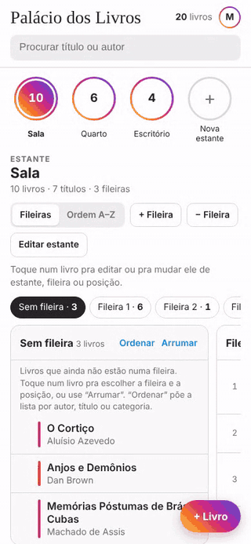

**English** · [Português (Brasil)](README.pt-BR.md)

# Book Palace

A simple, phone-first web app to manage a stock of books shelf by shelf, row by row, down to each book's exact position. It was made for a family's used-book stock: find any book in seconds and know where every new book goes.

It runs in the browser with nothing to install and can be hosted for free on **GitHub Pages**. The data lives in a **Firebase** database (free plan), with Google sign-in.

> The app's screens are in Brazilian Portuguese, where it is called *Palácio dos Livros*. The code and its comments are in English.

<p align="center"></p>

## Features

- **Shelves as "stories"**: each shelf shows up at the top, with its book count.
- **Rows side by side**: each row becomes a column, and books are listed top to bottom in the same order they stand left to right on the real shelf. On a computer, the arrows and the mouse wheel over the row bar jump from one row to the next.
- **Moving books**: on a phone, tap a book and pick its shelf, row and position. On a computer you can also drag it with the mouse to another position or row, and the bar that appears at the bottom sends it to another shelf.
- **Books not on a row yet** wait in their own list. Change its order from the book's editor or by dragging, or sort it by author, title or category.
- **Arrange without typing**: after tidying a real row, tap its last book and every book before it in that list goes to that row, in the same order. You can also tap them one by one.
- **Suggested A–Z order**: by the author's name as printed on the cover (Dan Brown files under D). Books by the same author stay together and series follow their volume order.
- **New books**: the app suggests the shelf (where the author's other books are) and the right A–Z position. If the book is already in stock, it says so and offers to add one more copy.
- **ISBN and barcode**: type the ISBN, or scan the barcode with the phone camera (Chrome on Android), and the title and author are filled in from Google Books or, if not found there, Open Library. The lookup goes straight from the browser to those services.
- **Several books in a row**: after a new book is saved, the form opens again on the same shelf, ready for the next one.
- **Search** by title, author, series or note, showing where the book is, like "Amarela · fileira 2 · 7º".
- **Backup**: download the stock as a spreadsheet (CSV) or as a backup file (JSON), and import that backup back.
- **Live updates**: a change made on one phone shows up right away on the others.
- **Dark mode**: follows the phone or computer setting, or can be set by hand in the account menu.

## Try it without setting anything up

With `FIREBASE_CONFIG = null` in `js/config.js`, which is how the project ships, the app opens in **demo mode**: no sign-in, a few sample books, and everything is stored only in your browser.

To run it on your computer, open a terminal in the project folder and run:

```bash
python3 -m http.server 8000
```

Then open `http://localhost:8000`. Double-clicking `index.html` doesn't work, because the app uses JavaScript modules.

## Put it online with your own stock

### 1. Create the Firebase project

1. Go to [console.firebase.google.com](https://console.firebase.google.com) with your Google account and click **Create a project**. Google Analytics can stay off.
2. On the project page, click the **Web** icon (`</>`) to register an app. Give it any name and leave Firebase Hosting unchecked.
3. Firebase shows a `firebaseConfig` object. Copy it into `js/config.js`, replacing `null`:

   ```js
   export const FIREBASE_CONFIG = {
     apiKey: "…",
     authDomain: "…",
     projectId: "…",
     storageBucket: "…",
     messagingSenderId: "…",
     appId: "…"
   };
   ```

   These values are **not secrets** and can live in a public repository. What protects the stock are the rules in step 3.

### 2. Turn on Google sign-in

1. In the Firebase menu, open **Authentication** and click **Get started**.
2. Under **Sign-in method**, enable **Google** and save.
3. Under **Settings > Authorized domains**, add your GitHub Pages domain, for example `your-user.github.io`.

### 3. Create the database and allow the e-mails

1. In the menu, open **Firestore Database** and click **Create database**. Pick a location close to you (for Brazil, `southamerica-east1 (São Paulo)`) and **production mode**.
2. Open the **Rules** tab, delete what is there and paste the contents of [`firestore.rules`](firestore.rules).
3. Replace the example e-mails with the Google accounts of the people who will use the stock, then click **Publish**.

To give someone access later, add their e-mail to the list and publish again.

### 4. Publish on GitHub Pages

1. Push the files to your GitHub repository, with `js/config.js` filled in.
2. In the repository, open **Settings > Pages**. Under **Source**, choose **Deploy from a branch**, then the `main` branch and the `/ (root)` folder, and save.
3. In a minute or two the app is live at `https://your-user.github.io/repository-name/`.

### 5. Add the books

Sign in with your Google account and either:

- **Import a backup**: use **Importar backup** at the bottom of the page. It takes the `.json` file the app itself creates under **Baixar backup**.
- **Start from scratch**: create the shelves with the **+** in the stories bar and add books with **+ Livro**.

### 6. On the phone

Open the address in the browser and use **Add to Home Screen**. The app gets an icon and opens like a regular app.

## How the data is stored

A `shelves` collection in Firestore, with one document per shelf:

```json
{
  "name": "Amarela",
  "order": 5,
  "rows": 6,
  "books": [
    { "id": "b12", "title": "O Código Da Vinci", "author": "Dan Brown", "category": "SUS", "copies": 11, "row": 2 },
    { "id": "b40", "title": "Lua Nova", "author": "Stephenie Meyer", "category": "FAN", "copies": 2, "row": 0, "series": "Crepúsculo", "volume": 2 }
  ]
}
```

| Field | Meaning |
|---|---|
| `category` | category code (the codes live in `js/config.js`) |
| `copies` | number of copies |
| `row` | row number, counting from the top (`0` = not on a row yet) |
| `note` | optional note, such as "sealed" or "pocket edition" |
| `series`, `volume` | optional series name and volume number |

A book's position within its row is its order in the list. Every change is saved in a transaction, so two people editing at the same time don't overwrite each other's work.

Firebase's free plan (Spark) comfortably handles a stock of thousands of books used by a family.

## Customize

- **Categories and colors**: `js/config.js`.
- **Look**: the colors are at the top of `css/style.css`.
- **A–Z order**: the rules are in `js/sort.js`.

## Project structure

```
index.html            the page
css/style.css         look and feel
js/config.js          Firebase settings and categories
js/app.js             screens, editing, drag and drop
js/store.js           Firebase and demo mode
js/sort.js            A–Z order by author
data/sample.json      demo mode books
firestore.rules       who can read and edit
docs/demo.gif         the animation at the top of this page
```

## License

Book Palace is free software under the [GNU Affero General Public License v3.0 or later](LICENSE), with additional attribution terms described in [NOTICE](NOTICE).

In short: you can use, study, change, share and even sell it, as long as:

- you keep the credit to Book Palace and ncsf01, with a link to this repository, visible in the app (for example, "Based on Book Palace by ncsf01" in the footer);
- you share the source code of your version under the same license, including when people only use it over the internet;
- you don't present a modified version as the original or name it "Book Palace".

The [LICENSE](LICENSE) and [NOTICE](NOTICE) files are what count; this summary is just a guide.
